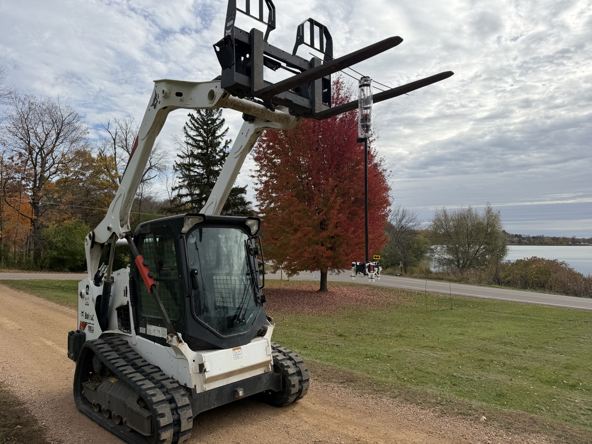
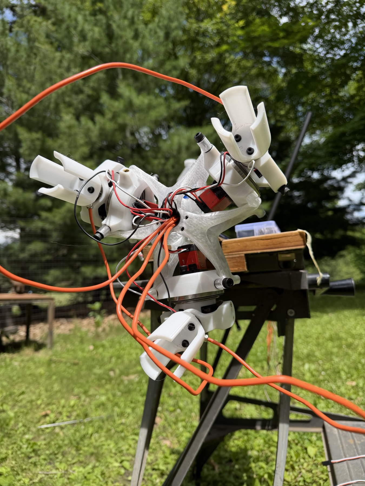
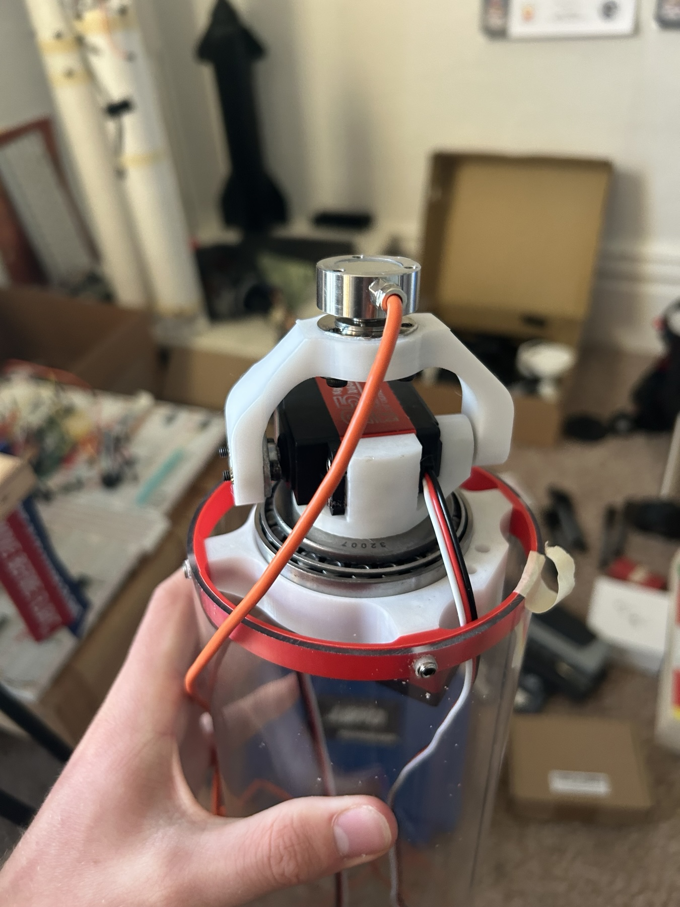
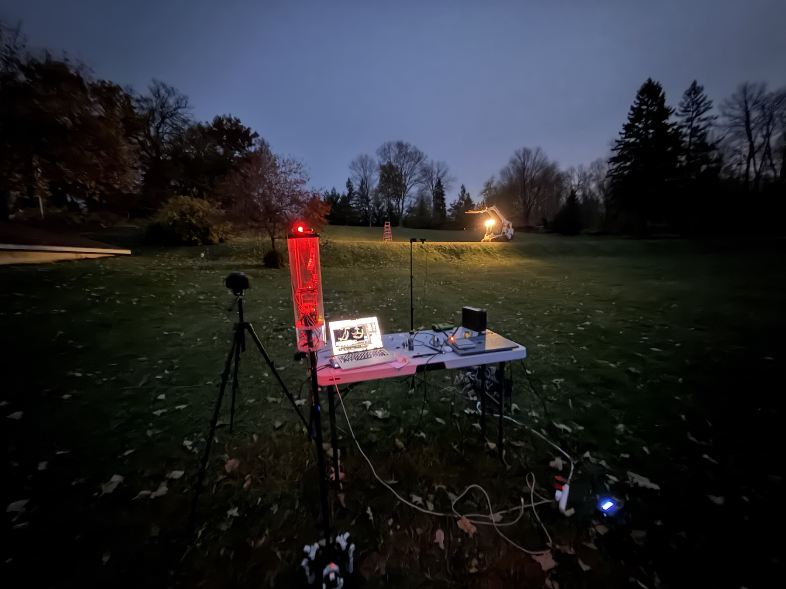

# TV3 Flight Control System

TV3 steers with three solid rocket motors mounted 120° apart at the base of the airframe. Once lit, each motor follows its own thrust curve. To reduce lift, TV3 tilts all three motors away from vertical. To correct its attitude, it steers the mounts individually. This repository contains the Cube Orange Plus flight software and the desktop simulator that runs the same C++ controllers.

## Table of Contents

- [Overview](#overview)
- [Gimbal Control](#gimbal-control)
- [Onboard Flight Software](#onboard-flight-software)
- [Flight Simulator](#flight-simulator)
- [Run the Hover Demo](#run-the-hover-demo)

## Overview



During preflight landing homing, TV3 hangs from the loader forks. The clear tube near the forks houses the avionics. The three white motor mounts sit at the opposite end of the long black boom.

One simulated landing profile starts TV3 **30 m east of the landing site**. It commands a low approach near 2 m altitude, slows for the final approach and turns the heading from 0° to 90° for the catch. That maneuver asks the gimbals to steer back toward the site and support the vehicle’s weight while the motors burn down. [Landing profile](config/profiles/real_landing_g12_launch30_low.json)

## Gimbal Control

In the G12 configuration, the three pivots sit 98 mm from the centerline. The mixer gives all three mounts a common fold angle (`a1`, 0–90°) to set the force along the airframe. It then chooses a separate steering angle for each mount (`a2`, up to 35° either side of center) to produce the requested roll, pitch and yaw torque. [G12 mount geometry](config/vehicles/tvc_ring3_g12.json) · [Firmware mixer](src/lib/tvc_core/src/allocator.cpp) · [Python mixer](sim_source/tvc/allocator.py)

<p>
  
  
</p>

Left, the three motor cradles on TV3’s thrust structure. Right, a single swerve mount with its red servo between the white pivot arms and its bearing visible underneath.

The Cube runs the mixer at 100 Hz. On each update, `thrusts` supplies a force estimate for each motor from its stored burn curve. As a motor burns down, the same gimbal deflection produces less torque.

```cpp
tvc::AllocResult alloc = _allocator.allocate_force_track(tau, force_target, force_weight, thrusts);
```

## Onboard Flight Software

Ground equipment ignites TV3. Once the Cube enters `LAUNCH_READY`, it watches for a sustained rise above the pad or upward velocity before starting the burn clock. A jolt on the pad alone cannot start that clock. The clock tells the thrust estimator where to sample each motor’s curve. [Liftoff detector](src/lib/tvc_core/include/tvc/first_motion.hpp) · [Thrust estimator](src/modules/tvc_thrust/TvcThrust.cpp)

The airframe harness groups the six servo outputs by axis. MAIN 1–3 steer mounts M0–M2 independently, and MAIN 5–7 fold them together. Each channel has its own trim and direction setting. [Actuator code](src/modules/tvc_actuators/TvcActuators.cpp) · [TV3 pin mapping](ROMFS/init.d/airframes/15000_tvc_ring3)



TV3 at the field station at dusk. The red-lit avionics tube is beside the laptop, with a tripod-mounted camera facing the setup.

Building for the Cube requires a separate PX4 checkout and toolchain. [Firmware build script](tools/build_cube_orange_plus.sh)

## Flight Simulator

The G12 simulation starts with a 2.6056 kg airframe and three 150 g AeroTech motors, for a loaded mass of 3.0556 kg. The Python model updates motor mass as propellant burns and tracks how each motor’s center of mass swings around its gimbal pivot. The mission and mixer run in Python. The attitude, position and altitude controllers run the same C++ code as the Cube. [Simulation loop](sim_source/tvc/flight_sim.py) · [Motor data](sim_source/vendor/Thrust-Curves-Apogee)

The model places the center of each motor halfway down its case, with 55 mm between the pivot and the mounting face. As a gimbal turns, its thrust direction changes and the motor’s mass moves with it. [Gimbal geometry](sim_source/tvc/geometry.py)

```python
offset = float(standoff_m) + 0.5 * motor_length_m(mount)
direction = thrust_direction(float(a2), float(a1), mount)
return np.asarray(mount.position, dtype=float) - direction * offset
```

## Run the Hover Demo

Run from the repository root on macOS or Linux with Python 3.12, CMake 3.16 or later, and a C++ compiler.

```sh
python3.12 -m venv sim_source/.venv
. sim_source/.venv/bin/activate
python -m pip install numpy matplotlib
./tools/build_host_tests.sh
python sih/run_sih.py --profile hover_hold_const --max-iters 1
```

The example asks a 1.9 kg constant-thrust model to climb from rest to 5 m. In the verified run, the model reached 5.03 m at its peak and ended at 5.02 m after 12 seconds. The runner prints the acceptance result and writes a time history of position, attitude, thrust and gimbal angles.

Replay the log in the 3D viewer on a desktop with a graphical display.

```sh
python tools/replay_sih_log.py sih/logs/hover_hold_const.csv \
  --vehicle sih/configs/vehicles/tvc_ring3_const.json
```

The solid-motor landing profiles exercise a different vehicle model. In the 30 m approach described above, the G12 model peaked at 1.76 m and contacted the ground before completing the catch. The simulator scored that run as a failed landing.
